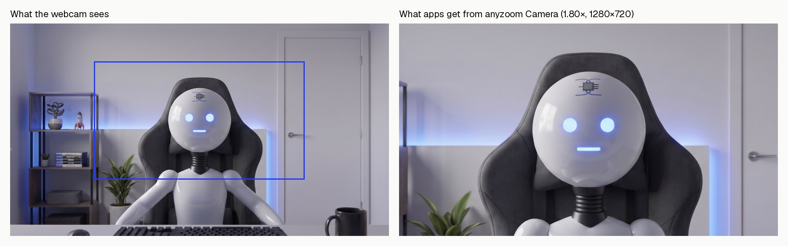
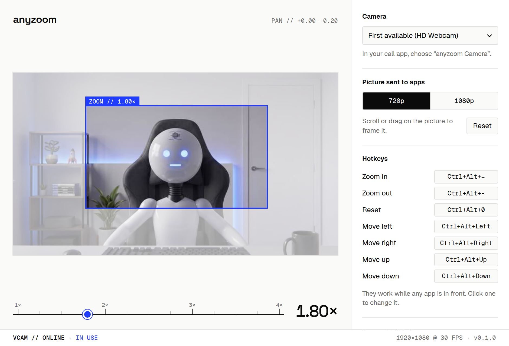
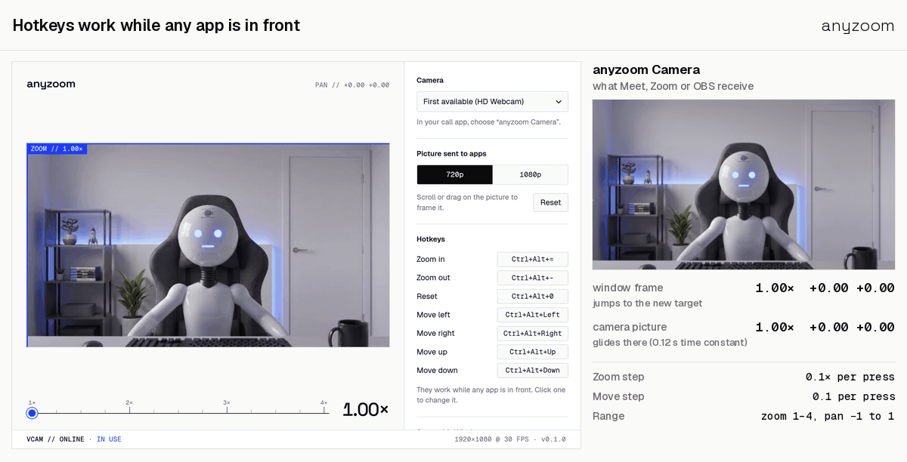
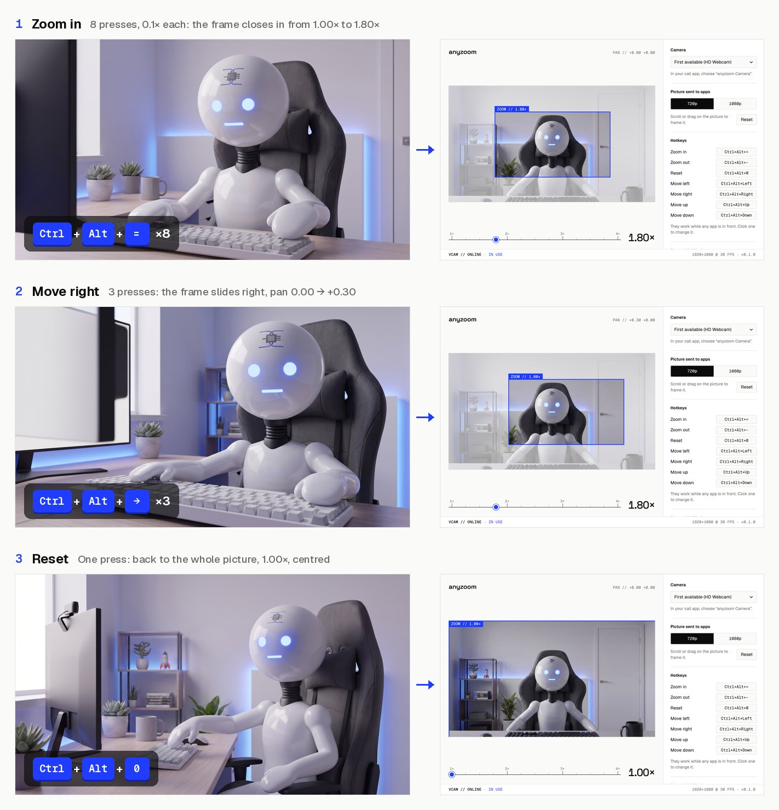
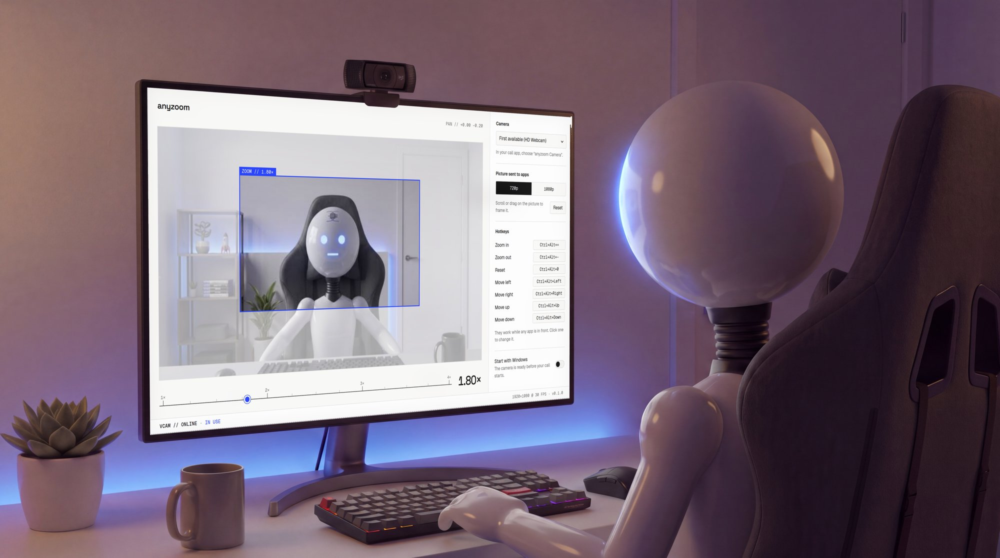

<p align="center">
  
</p>

<h1 align="center">anyzoom</h1>

<p align="center">Zoom and pan for any webcam on Windows 11.</p>

<p align="center">
  <a href="https://github.com/3E-Labs/anyzoom/releases">Download</a> ·
  <a href="#install">Install</a> ·
  <a href="#using-it">Using it</a> ·
  <a href="#how-it-moves">How it moves</a> ·
  <a href="#how-it-works">How it works</a> ·
  <a href="#build-from-source">Build from source</a>
</p>

<p align="center">
  <a href="https://github.com/3E-Labs/anyzoom/actions/workflows/release.yml"></a>
  
  <a href="LICENSE"></a>
</p>

<p align="center"><sub>An open source tool from <a href="https://github.com/3E-Labs">3E Labs</a></sub></p>

<p align="center">
  
</p>

---

Many webcams have no zoom at all. anyzoom takes the picture from the camera
you already own, lets you zoom from 1× to 4× and move around inside it, and
offers the result to every other app as a camera called **anyzoom Camera**.
Pick that camera in Meet, Zoom, Teams, Discord or OBS and they get your framed
picture.

No driver, no account, no network. One small app and one Windows camera
component.

<p align="center">
  
</p>

## Requirements

- Windows 11 (the virtual camera uses a feature Windows 10 does not have)
- Any webcam Windows can see

## Install

1. Download the zip from the [releases page](https://github.com/3E-Labs/anyzoom/releases) and unzip it anywhere.
2. Double-click `install.cmd`. Windows asks for administrator permission once,
   to register the virtual camera.
3. Open **anyzoom** from the Start Menu.
4. In your call app, choose **anyzoom Camera** as the camera.

To remove it, run `uninstall.cmd` from `C:\Program Files\anyzoom`.

### "Windows protected your PC"

This first release is not code-signed, so SmartScreen may warn when you run
it. Choose **More info**, then **Run anyway**. If you would rather not trust a
download, build it yourself from this source (see [Build from source](#build-from-source)).

## Using it

<p align="center">
  
</p>

- Drag the slider, or scroll on the picture, to zoom.
- Drag the blue frame to choose which part of the picture is sent. Double-click
  it to reset.
- Hotkeys work while any app is in front (see [How it moves](#how-it-moves)).
  Click a hotkey in the window to change it. If another program already owns
  a combination, anyzoom tells you which one is not working.
- Zoom and moves glide rather than jump, so a change during a call looks like
  a camera move, not a cut.
- Closing the window keeps anyzoom running in the system tray, so your call
  keeps its picture. Right-click the tray icon and choose **Quit** to stop it.
- **Start with Windows** (off by default) starts anyzoom in the tray so the
  camera is there before your call starts.

## How it moves

<p align="center">
  
</p>

Every hotkey press moves the view by one fixed step:

| Action | Default keys | Each press |
| --- | --- | --- |
| Zoom in | `Ctrl+Alt+=` | +0.1×, up to 4× |
| Zoom out | `Ctrl+Alt+-` | −0.1×, down to 1× |
| Move left / right | `Ctrl+Alt+Left` / `Ctrl+Alt+Right` | pan −0.1 / +0.1 |
| Move up / down | `Ctrl+Alt+Up` / `Ctrl+Alt+Down` | pan −0.1 / +0.1 |
| Reset | `Ctrl+Alt+0` | back to 1×, centred |

Pan runs from −1 (the frame against the left or top edge of the picture) to
+1 (against the right or bottom edge), with 0 in the middle. At 1× the frame
already covers the whole picture, so moving shows no change until you zoom in.

The blue frame in the window jumps to the new position at once. The picture
apps receive follows it smoothly: each frame it covers part of the remaining
distance, about 63% every 0.12 s, so a run of presses looks like one steady
camera move rather than a series of cuts. Dragging the slider or the frame,
scrolling on the picture and the **Reset** button set the same target and
glide the same way.

<p align="center">
  
</p>

<p align="center">
  
</p>

### Good to know

- **anyzoom Camera only exists while anyzoom is running.** After Quit it
  disappears from other apps' camera lists.
- Your real camera is switched on only while the anyzoom window is showing its
  preview or another app is using anyzoom Camera. About three seconds after
  both stop, anyzoom lets go of it and its light goes off.
- Only one program can use a physical camera at a time. If another app holds
  your webcam directly, anyzoom Camera shows a "camera unavailable" card until
  that app lets go.
- Zoom is digital: it crops and enlarges. With a 1080p webcam and the default
  720p output, zoom up to 1.5× loses no detail.
- **Picture sent to apps** (720p or 1080p) sets the size anyzoom produces.
  anyzoom Camera offers apps both sizes; if an app asks for the other one,
  the picture is rescaled to fit.
- The output is always 16:9. A 4:3 camera is cropped to fill it.
- One Windows account per PC: the file video passes through is private to the
  first account that runs anyzoom. For another account to use it, an
  administrator has to delete `C:\ProgramData\anyzoom` first (uninstalling
  does that).

## What it does not do

- macOS, Linux or Windows 10
- Face tracking, backgrounds, filters, recording
- Driving a camera's own optical or firmware zoom
- Anything with your microphone

## Privacy

anyzoom never connects to the network. It has no telemetry, no account and no
update check. Video goes from your camera to the app you choose, on your PC,
and nowhere else. Settings are stored in `%APPDATA%\anyzoom\settings.json`.

anyzoom only reads video from your camera. It never changes camera settings
or sends vendor-specific commands to the device.

## How it works

anyzoom is two programs that share one file:

```
webcam ──► anyzoom.exe ──► C:\ProgramData\anyzoom\frame.bin ──► anyzoom_vcam.dll ──► Meet, Zoom, OBS…
           (your account)        (memory-mapped)                (Windows camera service)
```

**Reading the camera.** The app opens the webcam with a Media Foundation
source reader. From the modes the camera offers it picks the largest one
that runs at about 30 fps and fits within 1080p, and asks Windows to deliver
it as NV12. It never sends control requests to the camera.

**Framing.** One worker thread takes each frame, finds the largest 16:9 area,
applies the zoom and pan inside it, and scales that area to the output size
with a fixed-point bilinear filter. Zoom and pan changes ease towards their
target with a 0.12 s time constant, so they glide without overshooting.

**Handing frames over.** The scaled NV12 frame is written into
`frame.bin`, a memory-mapped file with a 64-byte header (a magic number, the
size, a sequence counter, and timestamps for the writer and the reader).
The sequence counter is odd while a frame is being written, so the reader can
tell a half-written frame from a whole one and retries. The folder's access
list allows only your account, the camera service (Local Service), SYSTEM and
administrators.

**The camera other apps see.** At startup the app calls
`MFCreateVirtualCamera` to add **anyzoom Camera** for your session; it is
removed again when the app quits. When an app opens it, the Windows camera
service loads `anyzoom_vcam.dll` (registered by `install.cmd` as a COM class)
and asks it for frames. The DLL checks the header before it reads anything:
the magic number, that the size fits the file, the sequence counter, and that
the frame is fresh, under a second old. It delivers frames at a steady 30 fps.
When there is no fresh frame it shows a "starting" or "camera unavailable"
card instead of freezing. Each request it serves also stamps the header, which
is how the app knows a call is using the camera and keeps the webcam open.

**The window.** A Tauri app with a React interface. The preview is the whole
camera picture, shrunk to 640 px wide and sent to the window about 15 times
a second; the blue frame marks the part that is sent. Hotkeys are global
shortcuts registered through Tauri, and **Start with Windows** is an entry in
your account's Run key.

```
crates/anyzoom-core         zoom, crop, scaling, easing, pacing, frame file format, settings (no OS calls, unit-tested)
crates/anyzoom-capture-win  finding and reading webcams (Media Foundation)
crates/anyzoom-vcam-win     the virtual camera: the DLL and the code that registers it for the session
crates/anyzoom-engine       the pipeline thread joining the three
app/                        the Tauri app and its React window
scripts/                    build, package, install, uninstall
```

## Build from source

On Windows, with Rust, Node 20+ and the Visual Studio C++ build tools:

```
cd app && npm ci && npm run build && cd ..
cargo build --release -p anyzoom-vcam-win --lib
cargo build --release -p anyzoom-app --features custom-protocol
```

Copy `target\release\anyzoom.exe` and `anyzoom_vcam.dll` next to the files in
`scripts\` and run `install.cmd`.

On Linux or WSL you can cross-compile with `cargo-xwin`: see
`scripts/build.sh` and `scripts/package.sh`.

Tests: `cargo test -p anyzoom-core` (zoom and crop, scaling, easing, pacing,
the frame file, settings; any platform) and `npm test` in `app/` (the
window's input handling). The Windows-only parts are checked by hand with
[docs/manual-test-checklist.md](docs/manual-test-checklist.md). Every pull
request runs both test suites and a Windows build; a version tag also attaches
`anyzoom-v<version>-windows-x64.zip` to the release.

## Security

anyzoom installs a component that runs inside the Windows camera service.
Please report security problems privately, not in a public issue: see
[SECURITY.md](SECURITY.md).

## Licence

MIT. See [LICENSE](LICENSE). The bundled fonts (Space Grotesk, Geist, Geist
Mono) are under the SIL Open Font License.

## About the pictures

The character in them is Triple E, the 3E Labs mascot. The scenes are
generated images; the key captions on the keyboard scenes were added
afterwards. The anyzoom window, on its own, on the monitors and in the
animation, is anyzoom's own interface code drawn in a browser, with a picture
of Triple E from his webcam as the camera feed. These are not screenshots
from Windows. In the animation and in the right half of the before-and-after
image, that picture is cropped with anyzoom's crop rule; in the animation it
also eases with the app's time constant, step by step from the same hotkey
values the code uses.

---

<sub><b>3E Labs</b> is a technology lab in New York. We make open source tools
anyone can use, datasets technical teams can rely on, and custom software for
companies and institutions. <a href="https://github.com/3E-Labs">More from 3E Labs</a>.
3E Labs is the public name of 3E Studios LLC.</sub>
